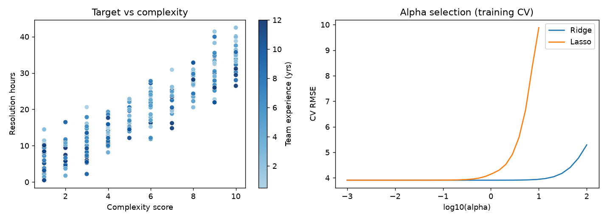
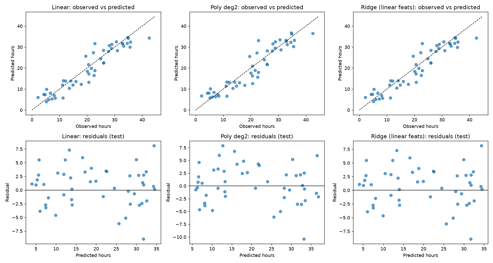

# Ticket Resolution Time Prediction

This project explores regression models for estimating how many hours a software support ticket will take to resolve. It includes the dataset, a Jupyter notebook, model results, and plots for exploratory analysis and prediction diagnostics.

## Project contents

- `lab_ticket_resolution.csv` — 240 ticket records with six columns.
- `Resoultion.ipynb` — notebook with data inspection, feature selection, model training, evaluation, and plots. The filename uses the spelling requested for this project.
- `results_table.csv` — cross-validation and held-out test metrics for the evaluated models.
- `fig_eda_alpha.png` — exploratory analysis figure.
- `fig_obs_vs_pred_residuals.png` — observed-versus-predicted and residual plots.

## Dataset and prediction setup

The target is `resolution_hours`. The features used for prediction are `complexity_score` and `team_experience_years`. `ticket_id` is an identifier, so it is not used as a predictor. `lines_changed` and `reopened` are excluded for an intake-time prediction because they may only be known after work has started or the ticket has been resolved. Feature availability should be checked against the intended real-world prediction time before using the model operationally.

The dataset has no missing values. Its other columns are `lines_changed` and `reopened`; they are present in the CSV but are not used in the selected feature set.

## Methods

The notebook creates an 80/20 train/test split with `random_state=42`. The training portion is used for fitting and five-fold cross-validation; the held-out test portion is reserved for final evaluation. Models include a mean `DummyRegressor`, ordinary linear regression, degree 2 and degree 3 polynomial regression, and scaled Ridge and Lasso regression.

The polynomial and regularized models use pipelines so feature expansion and scaling are performed as part of model fitting. Ridge and Lasso select their regularization strength (`alpha`) using cross-validation on the training data.

## Results

Held-out test metrics from `results_table.csv` (errors are in hours):

| Model | MAE | RMSE | R² |
|---|---:|---:|---:|
| Mean baseline | 9.114 | 10.598 | -0.021 |
| Linear regression | 2.906 | 3.572 | 0.884 |
| Polynomial degree 2 | 3.020 | 3.741 | 0.873 |
| Polynomial degree 3 | 3.140 | 3.949 | 0.858 |
| Ridge, linear features | 2.906 | 3.571 | 0.884 |
| Lasso, linear features | 2.906 | 3.572 | 0.884 |
| Ridge, degree 3 features | 2.995 | 3.714 | 0.875 |
| Lasso, degree 3 features | 2.981 | 3.699 | 0.876 |

Linear regression is the recommended starting model: it substantially improves on the mean baseline and slightly outperforms the polynomial models on this test split, while remaining simpler. Ridge and Lasso with linear features have effectively the same test performance.

## Diagnostic plots

### Exploratory analysis



### Observed versus predicted values and residuals



Residual plots should be checked for curvature, changing error spread, and unusually large errors. The test metrics are from one split of a relatively small dataset, so further evaluation on later tickets or repeated time-aware splits would be useful before deployment.

## Run the notebook

Install the required packages if needed:

```bash
python -m pip install pandas numpy matplotlib scikit-learn jupyter
```

Open `Resoultion.ipynb` in Jupyter and run the cells in order from this directory so the notebook can find `lab_ticket_resolution.csv` and the plot files.
